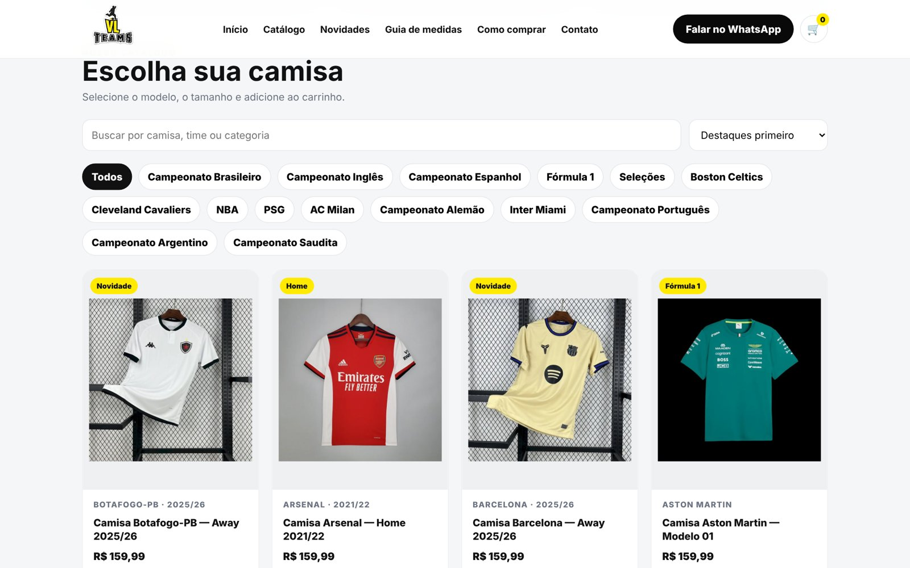
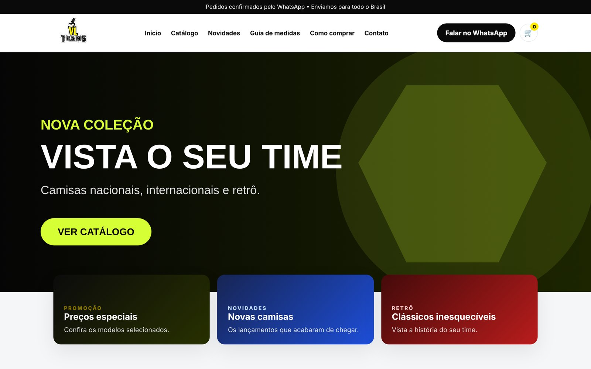
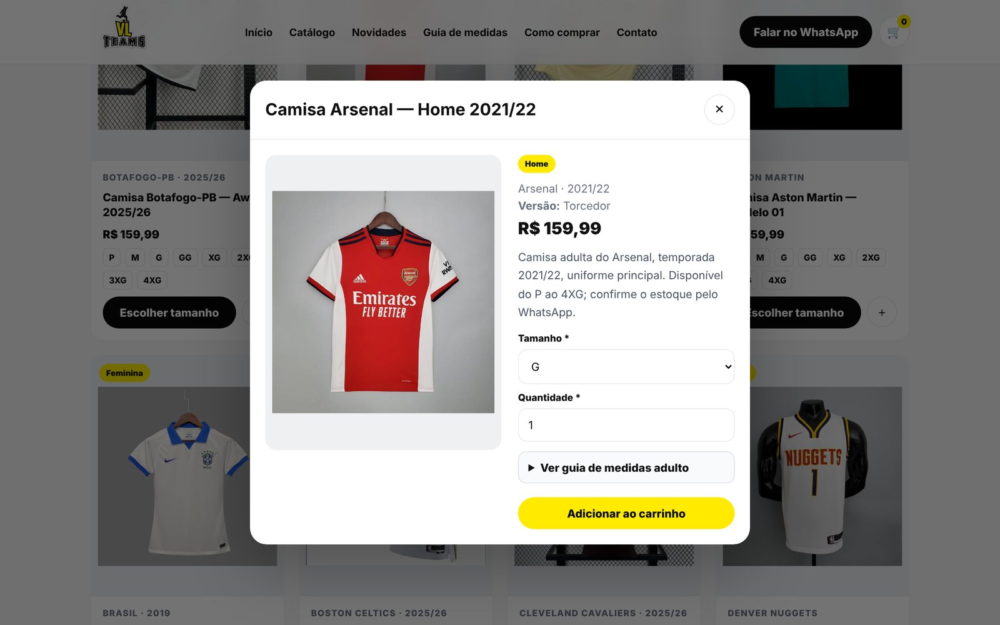
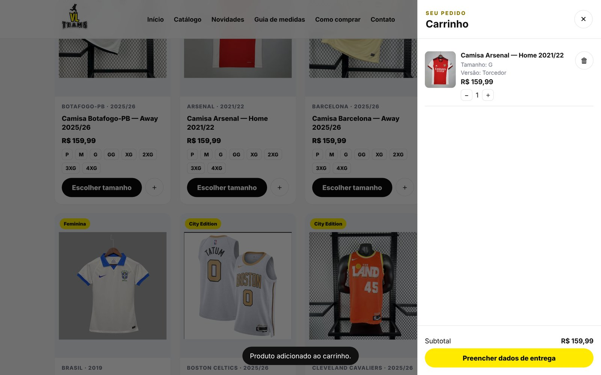
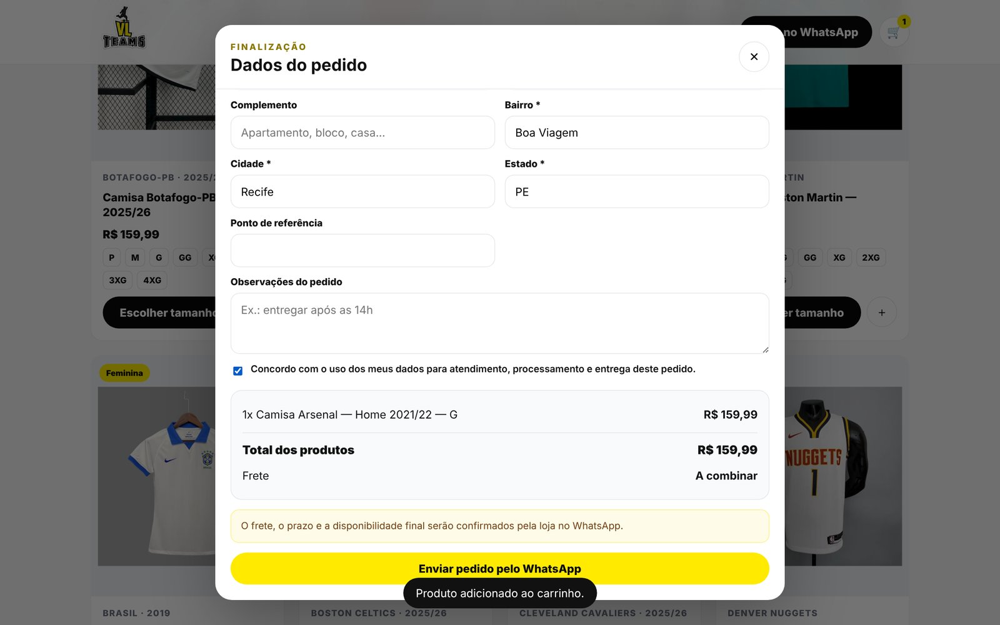
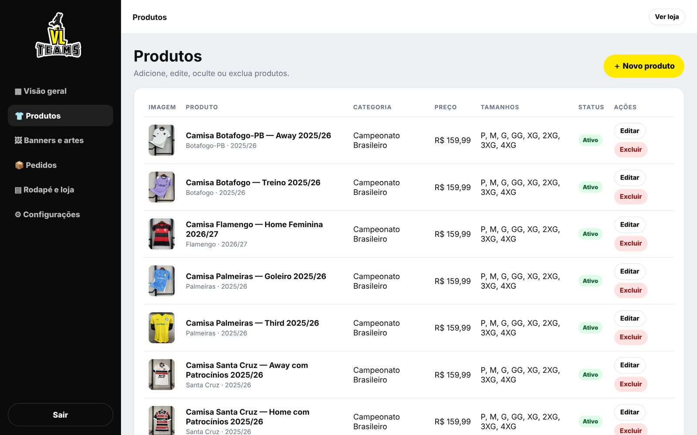
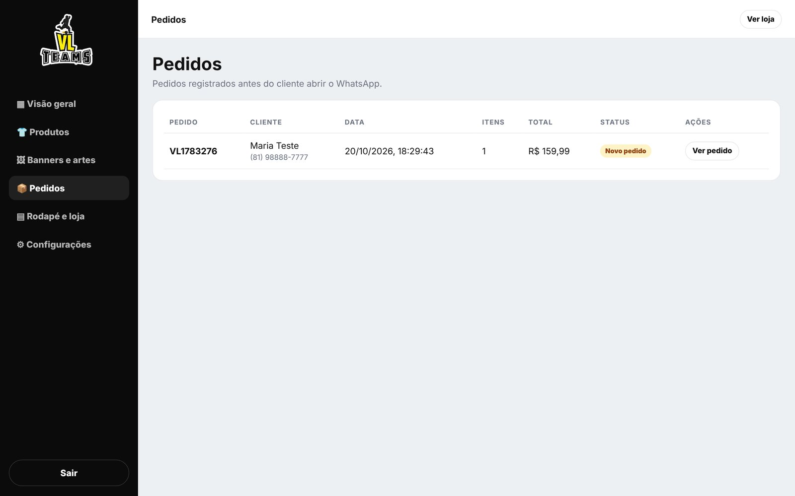
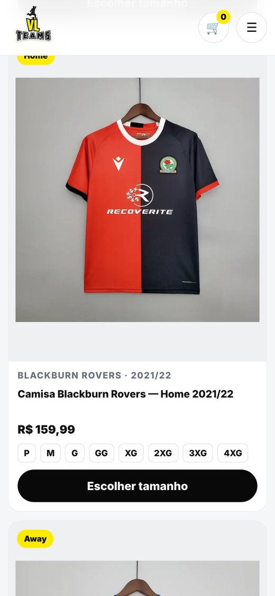

<h1 align="center">VL Teams · Loja de Camisas Esportivas</h1>

<p align="center">
  Loja virtual com catálogo, carrinho e checkout que envia o pedido pelo WhatsApp, além de um
  painel administrativo para gerenciar produtos, banners, pedidos e configurações da loja.
</p>

<p align="center">
  <a href="https://caiobandeira.github.io/vl-teams-loja/"><strong>▶ Ver a loja</strong></a>
  ·
  <a href="https://caiobandeira.github.io/vl-teams-loja/admin.html"><strong>Painel administrativo</strong></a>
</p>

<p align="center">
  
  
  
  
  
</p>



> **Acesso de demonstração ao painel:** `admin@vlteams.com` / `demo1234`
> Tudo o que você cadastrar ou alterar fica salvo só no seu navegador. O WhatsApp da demonstração é um número fictício.

---

## 📌 Sobre o projeto

Site desenvolvido para a **VL Teams**, loja de camisas de futebol, basquete e Fórmula 1 que vende pelo
Instagram e pelo WhatsApp. O objetivo era sair do "manda foto no direct" e ter um catálogo organizado,
onde o cliente escolhe modelo e tamanho, preenche os dados de entrega e já envia o pedido completo
para a loja.

A versão em produção tem **mais de 1.200 produtos em 114 categorias**. Este repositório traz uma
**vitrine com 49 produtos** (as fotos originais somam quase 900 MB).

## ✨ Funcionalidades

### Loja
- Banner rotativo (carrossel) e vitrine de destaques
- Catálogo com **filtro por categoria**, **busca** por time ou modelo, ordenação e "carregar mais"
- Página do produto com galeria de fotos, seleção de tamanho (P ao 4XG), quantidade e guia de medidas
- Preço automático por tipo de camisa (torcedor, jogador ou retrô)
- **Carrinho** lateral salvo no navegador
- **Checkout** com máscara e validação de CPF e telefone, e **preenchimento automático do endereço pelo CEP** (API ViaCEP)
- Envio do pedido formatado para o **WhatsApp** da loja, já com itens, tamanhos, total e endereço

### Painel administrativo (`admin.html`)
- Login de acesso
- **Visão geral** com produtos ativos, banners, pedidos em aberto e valor dos pedidos pagos
- **Produtos**: cadastrar, editar, ocultar e excluir, com fotos, tamanhos, estoque, selo e destaque
- **Banners e artes** da página inicial
- **Pedidos**: todo pedido enviado pela loja fica registrado, com status (novo, pago, enviado…)
- **Rodapé e loja**: WhatsApp, Instagram, horário de atendimento, textos de frete e privacidade

## 🖼️ Telas

| Página inicial | Produto |
|---|---|
|  |  |

| Carrinho | Checkout |
|---|---|
|  |  |

| Painel: produtos | Painel: pedidos |
|---|---|
|  |  |

<p align="center"></p>

## 🛠️ Tecnologias e decisões técnicas

- **HTML, CSS e JavaScript puro**, sem framework e sem etapa de build: o site roda em qualquer hospedagem estática (GitHub Pages, Netlify).
- **Separação em camadas**:
  - `js/store.js` é a camada de dados: catálogo padrão e funções de leitura e gravação no `localStorage`, com chaves versionadas (`vl_products_v17`) para migrar dados antigos sem quebrar a loja;
  - `js/app.js` cuida da loja (renderização, filtros, carrinho, checkout);
  - `js/admin.js` cuida do painel administrativo.
- **Integração com a API ViaCEP** (`fetch`) para buscar o endereço a partir do CEP.
- **Pedido via link `wa.me`**: a mensagem é montada com `encodeURIComponent` e abre direto na conversa com a loja.
- Proteção contra injeção de HTML: todo texto vindo de cadastro passa por `escapeHTML` antes de ir para a tela.
- **Layout responsivo** com CSS Grid e menu adaptado para celular.

> **Limitação conhecida:** como é um site estático, os dados ficam no navegador e o login do painel é
> verificado no próprio front-end. Para uso com vários administradores, o próximo passo é levar
> produtos, pedidos e autenticação para um back-end (por exemplo Supabase ou Firebase).

## 📁 Estrutura

```
vl-teams-loja/
├── index.html          # loja
├── admin.html          # painel administrativo
├── css/styles.css
├── js/
│   ├── store.js        # dados e persistência (localStorage)
│   ├── app.js          # lógica da loja, carrinho e checkout
│   └── admin.js        # lógica do painel
├── assets/             # logo, banners e fotos dos produtos
└── iniciar-site.bat    # abre um servidor local no Windows
```

## 🚀 Como rodar

Acesse a [versão online](https://caiobandeira.github.io/vl-teams-loja/), ou rode no seu computador:

```bash
# Windows: dê dois cliques em iniciar-site.bat
# ou, em qualquer sistema, com Python instalado:
python -m http.server 8080
# depois abra http://localhost:8080
```

## 👤 Autor

**Caio de Araújo Bandeira**
[LinkedIn](https://www.linkedin.com/in/caio-de-ara%C3%BAjo-bandeira-leite-b47507367) · [GitHub](https://github.com/caiobandeira)
